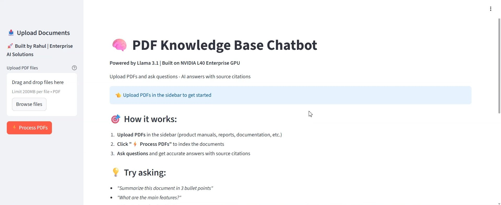
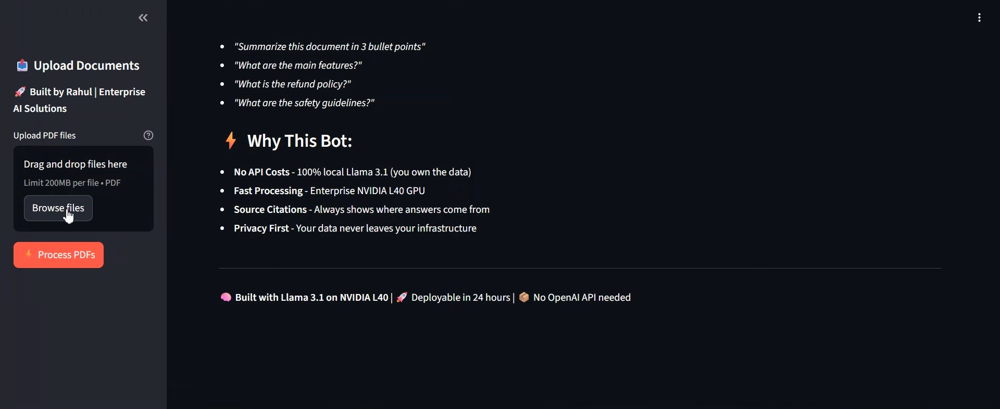
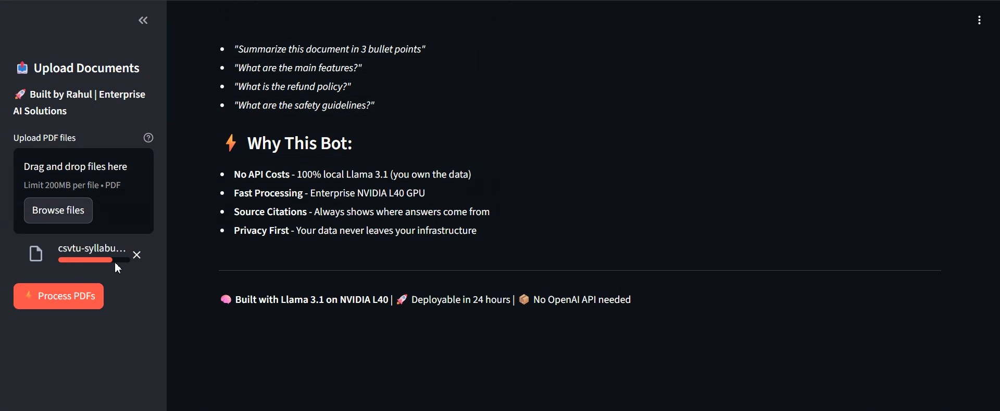
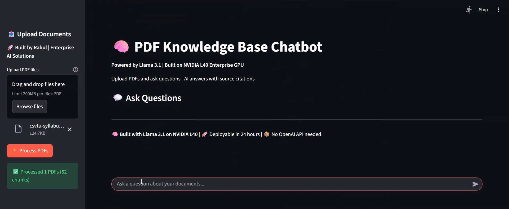
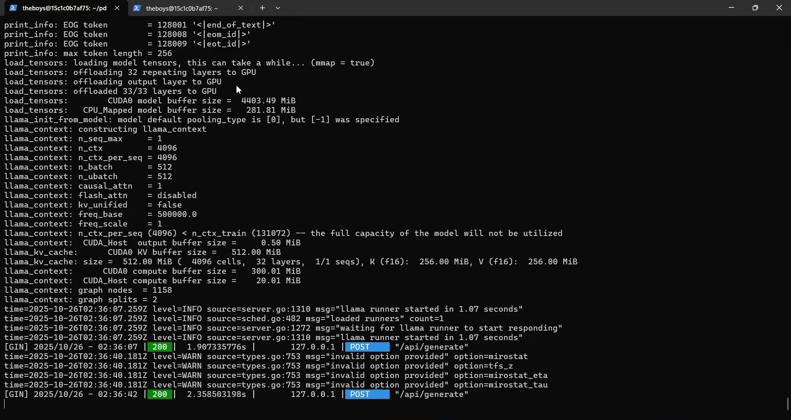
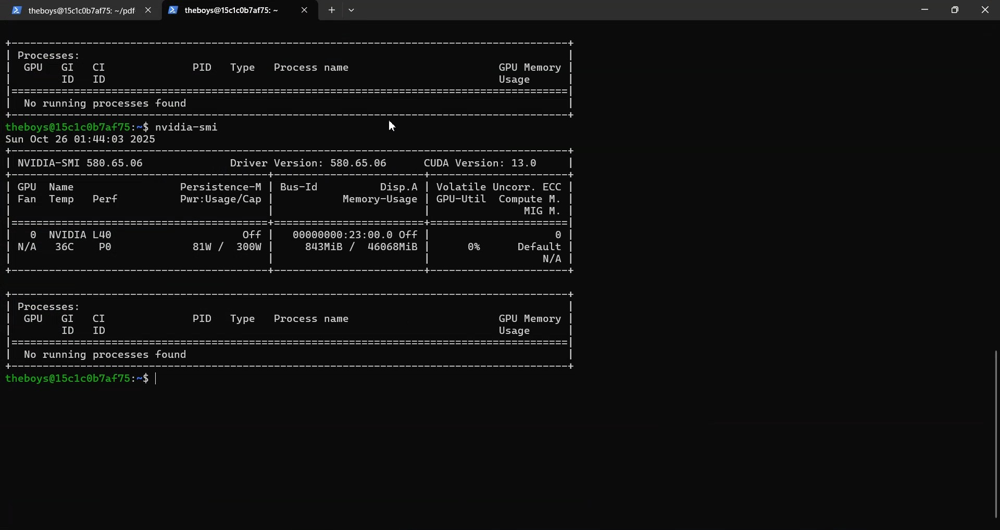

# 🧠 PDF RAG Chatbot with L40 GPU

Document Q&A app built with Retrieval Augmented Generation: upload PDFs, ask questions, and get answers from a local Llama 3.1 8B model, with the retrieved source passages and page numbers shown in the UI.

## 🎯 Overview

The app ingests PDF documents, splits them into chunks, embeds them into a vector store and answers questions using the most relevant chunks as context for a local LLM. Everything runs on your own machine: the LLM is served by Ollama, so no external LLM API is needed. Tested on an NVIDIA L40 GPU at about 2 s per answer.

---

## ✨ Features

- **🔍 RAG pipeline:** Sentence embeddings + semantic search (top-3 chunks) for context retrieval
- **📚 Multi-PDF upload:** Upload and index several PDFs at once
- **📖 Source passages:** Each answer has an expandable list of the 3 retrieved passages with their page numbers
- **🏠 Local inference:** Llama 3.1 8B via Ollama — no OpenAI/external LLM API needed
- **⚡ GPU-accelerated:** Tested on an NVIDIA L40 (46 GB) — about 2 s per answer in testing
- **💬 Chat UI:** Streamlit chat interface with on-screen history

---

## 🏗️ Architecture

```
User Upload → PyPDF Parser → Text Chunking (1000 chars, 200 overlap)
                                    ↓
                            Sentence Embeddings (all-MiniLM-L6-v2)
                                    ↓
                            ChromaDB (Vector Store)
                                    ↓
Query → Semantic Search (k=3) → Context Retrieval
                                    ↓
                      Llama 3.1 8B (Ollama) + Prompt
                                    ↓
                      Answer + Source Passages (with page numbers)
```

---

## 🛠️ Technical Stack

| Component | Technology |
|-----------|-----------|
| **LLM** | Llama 3.1 8B via Ollama |
| **Embeddings** | Sentence Transformers (all-MiniLM-L6-v2) |
| **Vector DB** | ChromaDB (persisted to `/tmp/chroma_db`) |
| **Framework** | LangChain + Streamlit |
| **PDF Processing** | PyPDF |
| **Text Splitting** | RecursiveCharacterTextSplitter |
| **GPU (tested)** | NVIDIA L40 46GB VRAM |

---

## 🎬 Demo Screenshots

### Landing Page

*Streamlit interface*

### Upload & Process

*Drag-and-drop PDF upload*


*Uploading a PDF*

### Ready for Questions

*PDF processed (52 chunks), ready for questions*

### Infrastructure

*Ollama log: all 33 model layers offloaded to the GPU; two answers took 1.9 s and 2.4 s*


*`nvidia-smi` on the NVIDIA L40 (46GB VRAM)*

---

## 🚀 Performance

- **Response Time:** about 2 s per answer in testing (NVIDIA L40, Llama 3.1 8B fully on GPU)
- **Privacy:** LLM inference is local — documents are not sent to an external LLM API

---

## 💡 Technical Highlights

- **Chunking:** 1000-character chunks with 200-char overlap
- **GPU Inference:** Local Ollama inference with the full model offloaded to the L40
- **Context Management:** Top-k=3 retrieval balancing relevance vs. token limits
- **Source Tracking:** PDF page metadata carried through the pipeline and shown with each retrieved passage

---

## ⚠️ Limitations

- **No chat memory:** each question is answered on its own; earlier messages are not sent to the model.
- **Not multi-user safe:** all uploads go into one shared Chroma collection in `/tmp/chroma_db`, so chunks from earlier uploads (including other users') can be retrieved.
- **Page numbers are 0-based:** pages are shown as PyPDF reports them, so the first page appears as "Page 0".

---

## 🛠️ Installation

### Prerequisites
- NVIDIA GPU (tested on L40)
- CUDA 12.x
- Ollama installed with Llama 3.1 model
- Python 3.10+
- Ubuntu/Linux recommended

### Setup

```bash
# Clone repository
git clone https://github.com/rahulkhunte/PDF-RAG-Chatbot.git
cd PDF-RAG-Chatbot

# Install dependencies
pip install -r requirements.txt

# Pull Llama 3.1 model (8B recommended for L40)
ollama pull llama3.1:8b

# Run application
streamlit run chatbot.py
```

### Configuration

Adjust in `chatbot.py` for your use case:

```python
# Chunk size (larger = more context, slower)
chunk_size=1000
chunk_overlap=200

# Number of relevant docs to retrieve
k=3

# LLM temperature (lower = more deterministic)
temperature=0.1

# Model selection
model="llama3.1:8b"  # or llama3.1:70b for larger GPU
```

---

## 📊 Use Cases

- Technical documentation search
- Research paper Q&A
- Product manual assistance
- Internal policy documentation

---

## 🔬 Future Enhancements

- Chat memory across questions
- Per-user / per-session vector collections
- Multi-modal support (images, tables from PDFs)
- Fine-tuned embeddings for domain-specific documents
- REST API for programmatic access
- Multi-language support

---

## 📄 Repository Structure

```
PDF-RAG-Chatbot/
├── chatbot.py              # Main Streamlit application
├── requirements.txt        # Python dependencies
├── README.md              # This file
└── screenshots/           # Demo screenshots
    ├── 01-landing.jpg
    ├── 02-upload.jpg
    ├── 03-processing.jpg
    ├── 04-question.jpg
    ├── 05-answer-sources.jpg
    └── 06-gpu-terminal.jpg
```

---

## 🌟 Related Projects

Check out my other AI/ML and Web3 work:

- **[DAMN - Decentralized AI Memory Network](https://github.com/rahulkhunte/DAMN-prototype)** - Ethereum + IPFS memory layer for autonomous agents
- **[AI Image Generation Bot](https://github.com/rahulkhunte/ai-image-bot)** - Telegram image-generation bot with Telegram Stars payments
- **[Crypto Whale Tracker](https://github.com/rahulkhunte/crypto-whale-tracker)** - Real-time Ethereum monitoring

---

## 👤 Developer

**Rahul Khunte**  
*AI/ML Engineer | GPU Computing | Infrastructure Optimization*

- 🌐 Portfolio: [rahulkhunte.github.io/portfolio](https://rahulkhunte.github.io/portfolio)
- 💻 GitHub: [@rahulkhunte](https://github.com/rahulkhunte)
- 📍 Location: Korba, Chhattisgarh, India
- 💼 Available for freelance AI/ML projects

---

## 📜 License

MIT License - feel free to use for your own projects

---

<div align="center">

**🧠 Built with Llama 3.1 on NVIDIA L40 | 💰 No LLM API Costs**

</div>
